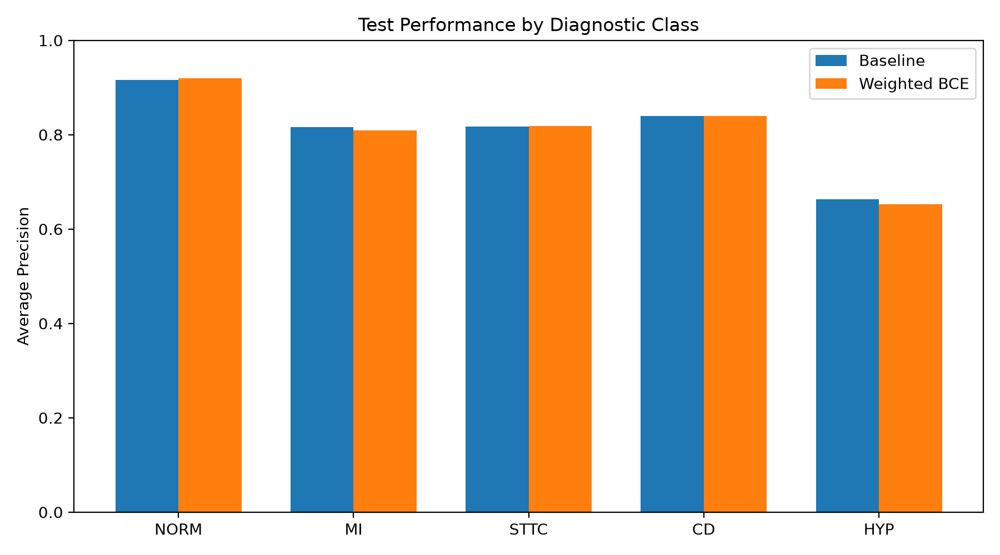
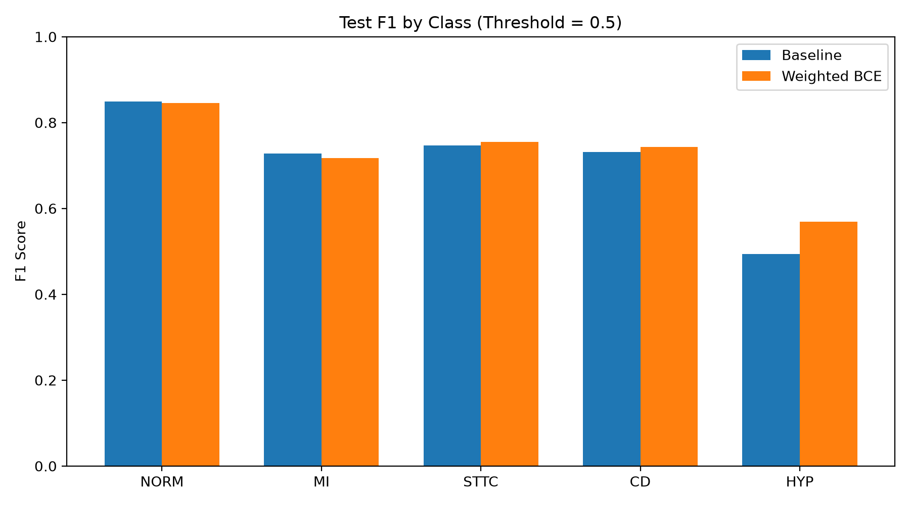
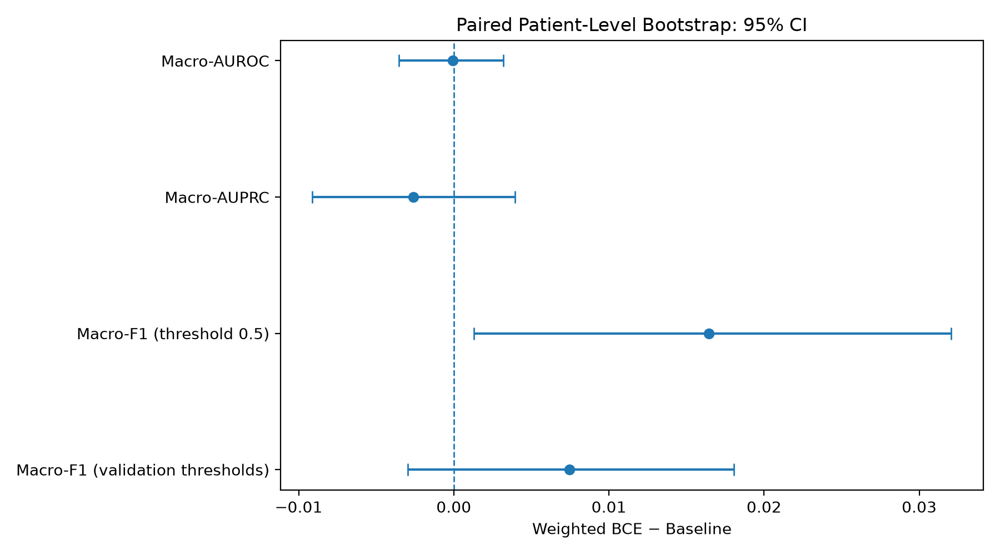

# Patient-Independent Multi-Label ECG Classification

A reproducible research project investigating multi-label electrocardiogram (ECG) classification, class imbalance, and evaluation uncertainty using the PTB-XL dataset.

## Project Overview

This project trains a lightweight 1D convolutional neural network (ECGCNN) to predict five diagnostic superclasses from 12-lead ECG recordings:

- **NORM** — Normal ECG
- **MI** — Myocardial infarction
- **STTC** — ST/T change
- **CD** — Conduction disturbance
- **HYP** — Hypertrophy

The primary research question is whether class-weighted binary cross-entropy improves classification performance for less frequent diagnostic classes without compromising overall ranking performance.

Two training configurations are compared:

1. **Baseline:** Standard `BCEWithLogitsLoss`.
2. **Weighted BCE:** `BCEWithLogitsLoss` with class-specific positive weights calculated from training labels.

The experiments use patient-independent training, validation, and test splits. Model selection and threshold optimization use validation data, while the held-out test set is reserved for final evaluation.

This is an experimental machine-learning project, not a clinically validated diagnostic system.

## Dataset

The project uses **PTB-XL v1.0.3**, a publicly available dataset of 12-lead ECG recordings.

- Dataset source: [PTB-XL on PhysioNet](https://physionet.org/content/ptb-xl/1.0.3/)
- Sampling frequency: 100 Hz
- Recording duration: 10 seconds
- Input dimensions: 12 leads × 1,000 samples
- Original metadata records: 21,799

### Label construction

Diagnostic superclass labels are derived from the SCP statements using the `diagnostic` and `diagnostic_class` fields in `scp_statements.csv`.

The five targets are represented as binary labels. Because this is a multi-label task, an ECG can have multiple positive diagnostic labels.

Of the 21,799 metadata records, 411 had no diagnostic superclass among the five target classes and were excluded from this experiment. The resulting dataset contains **21,388 ECGs**.

### Patient-independent data splits

The dataset uses the official PTB-XL fold assignments:

| Split | Folds | ECGs | Patients |
|---|---|---:|---:|
| Training | 1–8 | 17,084 | 14,823 |
| Validation | 9 | 2,146 | 1,917 |
| Test | 10 | 2,158 | 1,877 |
| **Total** | | **21,388** | **18,617** |

A patient-overlap check found no patients shared across the three splits.

Training-set signal statistics are used for normalization of training, validation, and test recordings.

## Repository Structure

```text
ECG-Classification/
├── data/
│   ├── raw/
│   │   └── ptb-xl/
│   ├── processed/
│   └── splits.csv
├── notebooks/
│   └── 01_ecg_exploration.ipynb
├── src/
│   ├── dataset.py
│   ├── model.py
│   ├── metrics.py
│   └── train.py
├── experiments/
│   ├── compute_train_stats.py
│   ├── prepare_cache.py
│   ├── run_baseline.py
│   ├── compare_validation_thresholds.py
│   ├── evaluate_test.py
│   ├── bootstrap_test.py
│   └── plot_final_results.py
├── tests/
├── outputs/
│   ├── metrics/
│   ├── plots/
│   ├── checkpoints/
│   └── runs/
├── config.py
├── requirements.txt
├── .gitignore
└── README.md
```

The raw dataset, processed signal arrays, temporary experiment runs, and model checkpoints are excluded from version control. Final summary tables and plots are intended to be retained for reproducibility.

## Installation

The commands below use Windows PowerShell.

### 1. Clone the repository

```powershell
git clone <YOUR_GITHUB_REPOSITORY_URL>
cd ECG-Classification
```

Replace the placeholder with the repository URL after publication.

### 2. Create and activate a virtual environment

```powershell
python -m venv .venv
.\.venv\Scripts\Activate.ps1
python -m pip install --upgrade pip
```

### 3. Install dependencies

For a CPU-only PyTorch installation:

```powershell
python -m pip install --index-url https://download.pytorch.org/whl/cpu torch
python -m pip install -r requirements.txt
```

If running from VS Code, select the Python interpreter inside `.venv` and select the same environment as the Jupyter notebook kernel.

### 4. Download and prepare the dataset

Download PTB-XL v1.0.3 from [PhysioNet](https://physionet.org/content/ptb-xl/1.0.3/) and place the dataset files in:

```text
data/raw/ptb-xl/
```

The directory should include at least:

```text
ptbxl_database.csv
scp_statements.csv
records100/
```

The `records100/` directory must contain the corresponding WFDB record files. The original dataset should remain outside version control.

Review the dataset's official license and terms before using or redistributing its files.

## Experimental Workflow

Run commands from the repository root with the virtual environment activated.

### 1. Prepare data

Download PTB-XL v1.0.3 from [PhysioNet](https://physionet.org/content/ptb-xl/1.0.3/) and place the dataset files under `data/raw/ptb-xl/`.

The repository includes the fixed patient-independent split index in `data/splits.csv` and training-only normalization statistics in `outputs/metrics/train_signal_stats.json`.

After downloading the dataset, prepare the normalized training and validation caches:

```powershell
python -m experiments.prepare_cache
```

The script reads the existing split index and normalization statistics. It creates caches only for the training and validation splits; the held-out test split remains uncached.

To intentionally recalculate normalization statistics from the training records, use `python -m experiments.compute_train_stats`. This script refuses to overwrite an existing statistics file, so back up or move the existing file before recalculating it.

The test split must not be used for training, model selection, normalization-statistic estimation, or threshold selection.

### 2. Run a training smoke test

The smoke test checks that the training pipeline executes without requiring a complete training run:

```powershell
python -m experiments.run_baseline --smoke-test
```

For the weighted configuration:

```powershell
python -m experiments.run_baseline --weighted-bce --smoke-test
```

Smoke tests do not save final model checkpoints.

### 3. Train the baseline and weighted models

```powershell
python -m experiments.run_baseline
python -m experiments.run_baseline --weighted-bce
```

Each run creates a timestamped directory under `outputs/runs/`. Record the checkpoint paths printed by the scripts.

The selected checkpoints correspond to the best validation Macro-AUPRC for their respective training configurations.

### 4. Select class-specific thresholds

Provide the checkpoint paths generated in the previous step:

```powershell
python -m experiments.compare_validation_thresholds `
  --baseline-checkpoint ".\outputs\runs\<baseline_run>\baseline_best.pth" `
  --weighted-checkpoint ".\outputs\runs\<weighted_bce_run>\baseline_best.pth"
```

Replace `<baseline_run>` and `<weighted_bce_run>` with the actual directory names.

The script selects per-class thresholds using validation predictions and writes `threshold_results.csv` to a new experiment directory.

### 5. Evaluate the held-out test set

```powershell
python -m experiments.evaluate_test `
  --baseline-checkpoint ".\outputs\runs\<baseline_run>\baseline_best.pth" `
  --weighted-checkpoint ".\outputs\runs\<weighted_bce_run>\baseline_best.pth" `
  --threshold-results ".\outputs\runs\<threshold_run>\threshold_results.csv"
```

Replace the placeholders with the actual paths from the preceding steps.

This step generates overall test metrics, per-class metrics, and per-ECG predictions. Do not tune models or thresholds based on the resulting test metrics.

### 6. Run paired patient-level bootstrap analysis

Use the prediction file produced by test evaluation and the same validation-derived threshold file:

```powershell
python -m experiments.bootstrap_test `
  --predictions ".\outputs\runs\<test_run>\test_predictions.csv" `
  --threshold-results ".\outputs\runs\<threshold_run>\threshold_results.csv"
```

The analysis uses 2,000 bootstrap repetitions and a fixed random seed of 20261022. ECGs from the same patient are kept together when sampling patients.

### 7. Generate final figures

```powershell
python -m experiments.plot_final_results `
  --test-dir ".\outputs\runs\<test_run>" `
  --bootstrap-dir ".\outputs\runs\<bootstrap_run>"
```

The supplied directories must contain `test_per_class.csv` and `bootstrap_summary.csv`, respectively.

The generated figures are saved under `outputs/plots/`.

### 8. Run the Tests

Run the complete test suite from the repository root:

```powershell
python -m pytest -v
```

The test suite covers:

- Model output dimensions, loss calculation, and gradient propagation.
- Multi-label classification metrics, including Macro-AUROC, Macro-AUPRC, and Macro-F1.
- ECG data loading, tensor shapes, and label integrity.
- Signal normalization using training-set statistics.
- Cached signal consistency, cache validation, and split restrictions.
- Training and validation loops, weight updates, and empty DataLoader handling.

The tests use synthetic ECG signals and do not require downloading the full PTB-XL dataset or preparing the signal cache.

To collect tests without executing them:

```powershell
python -m pytest --collect-only -v
```

To run a specific test module:

```powershell
python -m pytest -v tests/test_training_loop.py
```

## Experimental Setup

| Property | Configuration |
|---|---|
| Model | Lightweight 1D CNN (ECGCNN) |
| Trainable parameters | 104,389 |
| Input | 12-lead, 1,000-sample ECG |
| Device | CPU |
| Task | Five-label multi-label classification |
| Model selection | Best validation Macro-AUPRC |
| Primary metric | Macro-AUPRC |
| Additional metrics | Macro-AUROC and Macro-F1 |

The positive class weights used in the weighted BCE experiment were calculated exclusively from training labels:

| Class | Positive weight |
|---|---:|
| NORM | 1.249 |
| MI | 2.901 |
| STTC | 3.081 |
| CD | 3.373 |
| HYP | 7.062 |

Both configurations use the same model architecture and training setup, with the loss function and associated positive weights being the intended experimental difference.

## Final Test Results

The reported results are from the held-out test set of 2,158 ECGs from 1,877 patients.

### Overall metrics

| Model | Macro-AUROC | Macro-AUPRC | Macro-F1 (0.5) | Macro-F1 (validation thresholds) |
|---|---:|---:|---:|---:|
| Baseline | **0.9198** | **0.8103** | 0.7096 | 0.7317 |
| Weighted BCE | 0.9198 | 0.8077 | **0.7261** | **0.7392** |

The baseline achieved the higher Macro-AUPRC, while weighted BCE achieved the higher Macro-F1 under both reported threshold settings.

### Per-class Average Precision

| Class | Baseline | Weighted BCE |
|---|---:|---:|
| NORM | 0.9157 | **0.9192** |
| MI | **0.8157** | 0.8090 |
| STTC | 0.8175 | **0.8188** |
| CD | 0.8391 | 0.8390 |
| HYP | **0.6635** | 0.6527 |

Average Precision (AP) is calculated using `sklearn.metrics.average_precision_score`. Macro-AUPRC is the unweighted mean of the five per-class AP values.

### Per-class F1 at threshold 0.5

| Class | Baseline | Weighted BCE |
|---|---:|---:|
| NORM | **0.8485** | 0.8449 |
| MI | **0.7276** | 0.7178 |
| STTC | 0.7472 | **0.7546** |
| CD | 0.7313 | **0.7437** |
| HYP | 0.4934 | **0.5692** |

Weighted BCE improved HYP F1 at the fixed threshold of 0.5, but its HYP Average Precision was lower. This suggests a change in the precision-recall trade-off rather than a consistent improvement in class ranking.

### Validation-selected thresholds

The following thresholds were selected independently for each class by maximizing validation F1.

| Class | Baseline | Weighted BCE |
|---|---:|---:|
| NORM | 0.46 | 0.68 |
| MI | 0.50 | 0.39 |
| STTC | 0.27 | 0.61 |
| CD | 0.40 | 0.73 |
| HYP | 0.22 | 0.61 |

These thresholds are selected on validation data and then applied unchanged to the test set.

## Visual Results

### Average Precision by diagnostic class



### F1-score by diagnostic class



### Paired patient-level bootstrap



## Statistical Analysis

A paired patient-level bootstrap with 2,000 resamples was used to estimate 95% confidence intervals for the test metrics and the differences between models. All ECGs belonging to a sampled patient were retained together.

The difference is defined as **Weighted BCE minus Baseline**.

| Metric | Difference | 95% confidence interval |
|---|---:|---:|
| Macro-AUROC | -0.0001 | [-0.0036, 0.0032] |
| Macro-AUPRC | -0.0026 | [-0.0091, 0.0040] |
| Macro-F1 (threshold 0.5) | +0.0164 | [+0.0013, +0.0321] |
| Macro-F1 (validation thresholds) | +0.0075 | [-0.0030, +0.0181] |

The confidence interval for the fixed-threshold Macro-F1 difference excludes zero. The intervals for Macro-AUROC, Macro-AUPRC, and validation-threshold Macro-F1 include zero.

These intervals quantify test-sample uncertainty conditional on the trained models. They do not account for variation across training seeds, model initialization, or training runs.

## Limitations

- Only one training run per configuration was evaluated. Performance across multiple random seeds remains untested.
- Evaluation used a single held-out test split from PTB-XL. External validation on an independent dataset is needed.
- Per-class thresholds were selected by maximizing validation F1 and may be optimistic for future data.
- The experiments assess classification metrics, not clinical utility or diagnostic safety.
- The comparison does not establish that class weighting consistently improves performance across training runs.
- The models and results have not been established as suitable for clinical decision-making.

## Conclusion

The baseline model achieved a test Macro-AUPRC of **0.8103** and Macro-AUROC of **0.9198**. Class-weighted BCE improved fixed-threshold Macro-F1, particularly for HYP, but did not improve overall Macro-AUPRC.

The results illustrate the trade-offs between class weighting, ranking performance, and threshold-dependent classification metrics. Additional multi-seed experiments, calibration analysis, and external validation would strengthen these findings.

## Citation and Data License

If you use PTB-XL in research, cite the original dataset publication:

Wagner, P., Strodthoff, N., Bousseljot, R.-D., Kreiseler, D., Lunze, F. I., Samek, W., & Schaeffter, T. (2020). *PTB-XL, a large publicly available electrocardiography dataset.* Scientific Data, 7, 154.

https://doi.org/10.1038/s41597-020-0495-6

Dataset page: https://physionet.org/content/ptb-xl/1.0.3/

Consult the dataset's official license and terms for permitted use and redistribution. A separate code license has not yet been specified for this repository; add an appropriate `LICENSE` file before public release.
